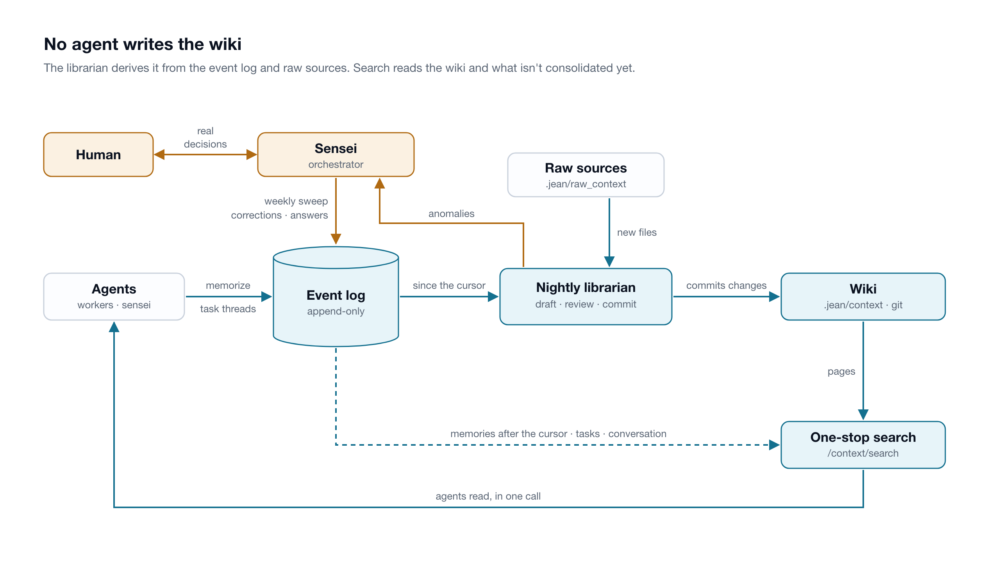
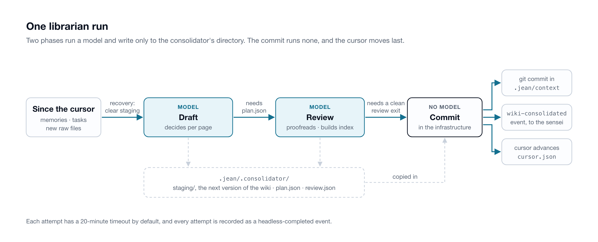

# The wiki

The wiki at `.jean/context/` is the dojo's distilled knowledge about the project and the human's preferences, written by the librarian and read by every agent, and improving with every run. It is one of the kinds of memory a dojo keeps; [Knowledge](knowledge.md) covers the others and the one search across them.

<picture>
  <source media="(prefers-color-scheme: dark)" srcset="diagrams/knowledge-loop-dark.png">
  
</picture>

Agents **memorize** what they learn, and their finished task threads carry the rest. Every night the **librarian** consolidates both into the wiki. Agents **read** through one search that also covers what isn't consolidated yet. Wrong pages are **corrected** through the same channel, by agents as they work and by the sensei's weekly **sweep**. What the librarian can't settle goes to the sensei as **anomalies**.

## Design principles

- **The event log is the main way in.** Memories and task threads are appended to the dojo's one append-only log, and the wiki is derived from it; raw sources are the only other input. Writers never contend, a bad consolidation can't lose what an agent recorded, and every wiki commit names the event range it covered.
- **One writer.** Only the librarian writes the wiki; every other role has `Edit` and `Write` on it denied, and humans don't edit it either. One writer keeps the shape and settles contradictions in one place. A correction is a memory like any other.
- **Consolidate in batches, search immediately.** Consolidation is a model run over a day's events, costly and better with the whole day's context. Search covers what isn't consolidated yet, so a memory is findable the moment it's recorded.
- **Built-in mechanisms for what must be consistent, skills for judgment.** A skill may not load, and it competes with everything else in context. Recording a memory is therefore a dedicated tool, and finding what the dojo knows is one search call. What to keep and how a page should read are left to skills.
- **Deterministic where it can be.** Only the draft and the review run a model. The commit, the cursor and the run's summary event are infrastructure code.
- **Every loop closes.** What the librarian can't settle reaches the sensei, and the answer comes back as a memory. Staleness is checked on a schedule, not left to whoever happens to notice.
- **Plain Markdown, navigated by an index.** Pages are files any agent can read, indexed by one-line descriptions rather than embeddings, so the wiki stays inspectable, diffable and versioned in git.

## Writing

**Memorize.** An agent that learns something worth keeping past the current task calls the `memorize` tool:

```
memorize(text="Release builds must run the migration check before tagging.", taskId="042")
```

The memory is appended to the log and searchable at once. It is for knowledge that crosses tasks: a convention the human stated, a finding, a gotcha in an external tool. Progress on the current task belongs in a task comment.

A memory exists only if the agent decides to record it, so the way to record it must be in front of the agent in every session. As an MCP tool, `memorize` sits in every session's tool list and its schema carries the instruction; an endpoint described in a skill depended on the skill loading and on the agent noticing it. For the same reason, agents don't write to Claude Code's own memory, which stays outside the log, search and the wiki. The `context` skill says so bluntly, because the harness's instructions load into every session and a skill's may not.

**Task threads.** When a task moves to `done`, the librarian reads its whole thread on the next run and distills what will matter to other tasks: a finding, a lesson, a decision and its reason. Task threads are where findings already are, so a finding reaches the wiki even when nobody memorized it.

**Raw sources.** The librarian also reads files added to `.jean/raw_context/` since its last run. Text is read in full; other files are cited by path from the pages they inform.

The draft keeps only what will last: a memory that is just task status, or not worth a page, is dropped.

## Pages

- **One concept per page**: one decision, convention, component or topic, so an update touches one page and a reader opens only what it needs. A page covering two concepts is split.
- **A `description:` in every page's frontmatter**, one sentence on what the page holds.
- **`index.md`** lists every page with its description, so a reader picks the one to three pages worth opening without opening the rest. The review rebuilds it on every run.
- **`[[wiki-links]]`** connect pages; **`log.md`** records each run that changed the wiki.

Pages carry no authorship: a page merges memories from many agents, and who recorded what stays in the event log. `.jean/context/` is its own git repository, one commit per run that changes it.

## Consolidation

The librarian is a headless Claude Code run (`claude -p`) in its own role directory, with no MCP servers. It reads the log and the wiki from disk and runs unattended; what it can't settle goes out as [anomalies](#anomalies). `jean dojo init` schedules it nightly at 03:00, alongside the sensei's weekly [sweep](#the-weekly-sweep). `jean trigger fire consolidate-wiki` runs it on demand, for a correction that should land before tonight.

<picture>
  <source media="(prefers-color-scheme: dark)" srcset="diagrams/knowledge-run-dark.png">
  
</picture>

A run has three phases. As one job, consolidation over a day's events ran long enough to be killed before it finished; each phase now has one job and narrow instructions, and the phase that needs no judgment runs no model.

1. **Draft** reads every memory and completed task since the cursor, plus new raw sources, and decides per page: create, update, keep or archive. It writes the next version of the wiki to staging, with its decisions and anomalies in `plan.json`.
2. **Review** proofreads the draft against the wiki's rules (one concept per page, descriptions that match, links that resolve, contradictions settled by the most recent evidence), rebuilds `index.md` and records its own anomalies.
3. **Commit** runs in the infrastructure: it copies staging into `.jean/context/`, commits to git, records a `wiki-consolidated` event with the run's summary, and advances the cursor.

The page rules hold as far as the models apply them. The pipeline guarantees the order of the phases, that a draft reaches the wiki only through a clean review, and that the cursor moves only after the summary event is recorded.

**Recovery.** Before the draft, recovery clears anything a run that stopped partway left behind, so every run starts from the last committed wiki.

**The cursor** (`.jean/.consolidator/cursor.json`) is the id of the last event the librarian read. It only moves forward, and only after the run's `wiki-consolidated` event is recorded, so a run that fails leaves it in place and the next run reads the same events again. It also marks the line search uses: memories after it are the unconsolidated ones.

**The commit** copies new pages in before removing dropped ones, so a reader never finds a page missing, and its subject names the event range it covered. An archived page, correct but historical, leaves current knowledge; git keeps every version. A run with nothing to change makes no commit but still records its event, so `log.md` lists the runs that changed the wiki and a `wiki-consolidated` event marks every run that finished.

## Reading

Left to themselves, agents read a wiki inconsistently: they open one page and miss a more relevant one, skip a page on its description, or grep the event log instead. An index alone doesn't fix that, since navigating it takes two reads where grep takes one, and the wiki lacks what isn't consolidated yet. So agents read the wiki through one search call:

```
GET /context/search?q=<terms>
```

Search is built for the wiki first, and extends past it to the memories not yet consolidated, the tasks and the conversation with the human through the bridge, so a fact is findable the moment it's recorded. Ranking puts the page about a topic first, since it names the topic in its title or description. An empty result is definitive for what was searched, so an agent can stop instead of grepping the log. `index.md` stays the way to browse. [Search](knowledge.md#search) has the scopes and the ranking rules.

## Keeping it true

The librarian revisits a page only when new input arrives, so it settles conflicts between what arrives and the pages it lands on. Three mechanisms keep the rest true.

### Corrections

Any agent that finds a page wrong memorizes a correction, prefixed `CORRECTION:`:

```
memorize(text="CORRECTION: release-process.md says releases are cut on Fridays. They moved to Tuesdays; see the release checklist in the repo.")
```

The draft turns it into an update of the page it names. A correction is a memory rather than an edit because the wiki has one writer and events can't be changed: a wrong memory is fixed by a newer one, and the next run folds in both. A correction made soon after the memory it fixes is read in the same run, so the corrected version is what reaches the wiki.

### The weekly sweep

A page nobody's work touches can go stale unnoticed, and the librarian can't see it either, since it reads only what's new. So every week, in every dojo, the sensei, which holds the widest context on the project, reads every page and asks two questions: is it still true, checked against the board, the repository and external systems; and does it belong in the wiki at all, rather than in project files, a skill or a playbook. Its findings go out as memories with three verbs: **`CORRECTION:`** (a claim is wrong, with the current truth and its source), **`ARCHIVE:`** (correct but historical), and **`REMOVE:`** (belongs elsewhere, and that home is verified to hold it). The librarian folds them in on its next run.

### Anomalies

The flow into the wiki runs one way, so rather than guess, the draft and the review record **anomalies**, the librarian's questions: what they couldn't settle, such as two pages contradicting each other with no clear winner, a page that has grown into two concepts, or a link to a page that doesn't exist. They travel on the `wiki-consolidated` event to the sensei's mailbox. The sensei settles routine ones itself, a page to split, a link to repoint, a contradiction the evidence already resolves, and brings only real decisions to the human. Either way the answer goes back in as a memory.

## Where it lives

**Files**, under the dojo's `.jean/`:
- `history.jsonl`: the event log, with memories, tasks, messages and `wiki-consolidated` events.
- `context/`: the wiki, a git repository of its own (`index.md`, `log.md`, the pages).
- `raw_context/`: raw sources.
- `.consolidator/`: the librarian's working directory: `staging/`, `plan.json`, `review.json`, `cursor.json`.
- `roles/librarian/`: the librarian's role directory, with its permissions and skills.
- `.headless/`: the transcript of every draft and review attempt.

**Skills**, sourced from `src/cli/skills/` and installed into each role's `.claude/skills/`:
- `consolidate-wiki-draft` and `consolidate-wiki-review`: the librarian's two model phases.
- `consolidate-wiki`: a reference overview of the whole procedure.
- `wiki-sweep`: the sensei's weekly sweep.
- `context`: every agent's guide to the dojo's memory: searching, memorizing, correcting.

**Triggers**: `consolidate-wiki`, the librarian, nightly, on the model the trigger names (Sonnet as provisioned); `wiki-sweep`, the sensei, weekly.

**Code**: `src/infra/librarian.ts` runs the pipeline; `src/domain/contracts/knowledge.ts` states what search promises, and `src/adapter/surfaces/knowledge.ts` serves it.

## Lineage

The wiki is a more structured take on Andrej Karpathy's [LLM Wiki](https://gist.github.com/karpathy/442a6bf555914893e9891c11519de94f): plain Markdown maintained by a model, `index.md` and `log.md` as anchors, cross-referenced pages, navigation by index rather than embeddings, and raw sources the model reads but never changes. What a dojo adds comes from many agents feeding one wiki while nobody watches the librarian work: a required page shape, the event log as the inbox, one writer, a cursor, unattended phases, search past the wiki, the weekly sweep and anomalies that reach the sensei.
